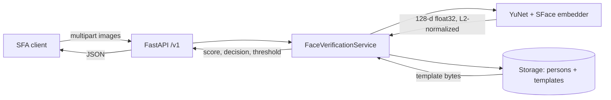

# facecheck

Minimal 1:1 face verification service for SFA attendance prototypes.

Give it a person's enrollment photos and a probe photo, and it answers one
question: **is this the enrolled person?** It does not try to identify who the
person is, and v0 deliberately does not attempt liveness detection, GPS
verification, or manual review.

The service is CPU-only, stores embeddings as plain bytes, and uses the
permissively licensed OpenCV Zoo models (YuNet + SFace) behind a small FastAPI
API. On the LFW test pairs it reaches **0.9945 ROC AUC** with **8.6 ms mean
detect-and-embed latency** per image; see [evaluation](#evaluation).

## Problem

SFA field attendance (SPG / promoter check-in) needs to confirm that the person
checking in is the person enrolled for that shift. Today this is often a
selfie + supervisor eyeball. facecheck reduces it to a deterministic 1:1
comparison:

1. Enroll a person once with 3-5 photos.
2. On check-in, send one probe photo.
3. Accept or reject based on a cosine threshold over face embeddings.

## Scope of v0

In scope:

- 1:1 verification (enroll, verify, delete, metadata)
- YuNet face detection with exactly-one-face and minimum-size quality gates
- SFace 128-dimensional embeddings, L2-normalized, stored as `float32` bytes
- Multiple templates per person, maximum cosine across templates
- SQLite by default, optional Postgres via docker-compose
- CLI comparison of two images
- LFW evaluation harness and reproducible report
- Unit tests that need no models + integration tests that skip without them

Out of scope (see [roadmap](#roadmap)):

- Liveness / anti-spoofing, deepfake or replay detection
- GPS, mock-location detection, Play Integrity
- 1:N identification or duplicate-person search
- Review queue, consent flows, retention policies
- Mobile SDK / client app

## Architecture



The embedder sits behind a `FaceEmbedder` protocol
(`detect_and_embed(bgr) -> EmbeddingResult`), so tests use a deterministic fake
and the production implementation is replaceable without touching the API or
storage layers.

### Design notes

- **Templates are not averaged.** Enrolling 3-5 photos stores 3-5 templates;
  verification takes the maximum cosine similarity against any of them.
  Averaging would blur pose and lighting variation that multiple templates are
  meant to capture.
- **Enrollment is atomic.** If any submitted image fails the quality gate, the
  request returns HTTP 400 with a per-image reason and no templates are written.
  Re-enrolling replaces the person's previous templates.
- **Model versions are enforced.** Each template records its `model_version`.
  Verification compares only templates from the current model and returns
  HTTP 409 if none match, instead of producing meaningless scores.
- **Strict quality gate.** Zero faces, more than one face, or a face whose
  shortest side is under 80 px is rejected. In a group photo the user must
  retake, which is intentional for a 1:1 attendance check.
- **No vector database.** A person has at most five 128-float templates, so
  brute-force cosine similarity is faster than any index and keeps deployment
  trivial.

## Quickstart

Requires Python 3.11+ (tested on 3.13) and no GPU.

```bash
python -m venv .venv
source .venv/bin/activate
python -m pip install -U pip
python -m pip install -e ".[dev]"

# Downloads ~39 MB of ONNX models into models/, verifying pinned SHA-256 digests
python scripts/download_models.py

uvicorn facecheck.api:app --reload --port 8000
```

Run the test suite:

```bash
pytest -v
```

Unit tests run everywhere. Tests marked `model` are skipped when
`models/*.onnx` is missing.

### Enroll and verify with curl

```bash
# 1. Create a person (external_id is optional and unique)
PERSON_ID=$(curl -s -X POST http://localhost:8000/v1/persons \
  -H 'Content-Type: application/json' \
  -d '{"external_id": "spg-001", "display_name": "Siti"}' \
  | python -c 'import json,sys; print(json.load(sys.stdin)["id"])')

# 2. Enroll 3-5 photos in one multipart request
curl -s -X POST "http://localhost:8000/v1/persons/$PERSON_ID/enroll" \
  -F files=@enroll-1.jpg \
  -F files=@enroll-2.jpg \
  -F files=@enroll-3.jpg
# {"enrolled":3,"model_version":"face_detection_yunet_2023mar+face_recognition_sface_2021dec"}

# 3. Verify a probe photo
curl -s -X POST "http://localhost:8000/v1/persons/$PERSON_ID/verify" \
  -F file=@probe.jpg
# {"score":0.7123,"decision":"match","threshold":0.363,"model_version":"..."}

# 4. Metadata / delete
curl -s http://localhost:8000/v1/meta
curl -s -X DELETE "http://localhost:8000/v1/persons/$PERSON_ID" -o /dev/null -w '%{http_code}\n'
```

A quality rejection looks like:

```json
{"detail": "one or more images failed the face quality gate",
 "reasons": [{"index": 1, "reason": "multiple_faces",
              "message": "expected exactly one face, detected 2"}]}
```

Reason codes: `no_face`, `multiple_faces`, `face_too_small`, `invalid_image`.

### CLI

```bash
python -m facecheck compare photos/a.jpg photos/b.jpg
# score=0.7123 decision=match threshold=0.3630 model=face_detection_yunet_2023mar+face_recognition_sface_2021dec
```

Exit code `0` means match, `1` means no match, `2` means an input/model error.
Use `--threshold` and `--models-dir` to override the defaults.

### API summary

| Method | Path | Body | Response |
| --- | --- | --- | --- |
| `POST` | `/v1/persons` | optional JSON `{external_id, display_name}` | `201 {id, external_id, display_name, created_at}` |
| `POST` | `/v1/persons/{id}/enroll` | multipart `files` (3-5 images) | `{enrolled, model_version}` |
| `POST` | `/v1/persons/{id}/verify` | multipart `file` | `{score, decision, threshold, model_version}` |
| `DELETE` | `/v1/persons/{id}` | - | `204` |
| `GET` | `/v1/meta` | - | `{model_version, threshold, embedding_dim, min_face_size}` |
| `GET` | `/healthz` | - | `{status}` |

Errors use `{"detail": "..."}`; quality and enrollment errors may add
`reason`/`reasons`. OpenAPI docs are at `/docs`.

### Configuration

All settings use the `FACECHECK_` prefix and can come from environment
variables or a local `.env` (see `.env.example`).

| Variable | Default | Meaning |
| --- | --- | --- |
| `FACECHECK_DB_URL` | `sqlite:///./data/facecheck.db` | SQLAlchemy URL; use `postgresql+psycopg://...` for Postgres |
| `FACECHECK_MODELS_DIR` | `models` | Directory containing the ONNX files |
| `FACECHECK_MATCH_THRESHOLD` | `0.363` | Cosine similarity threshold |
| `FACECHECK_MIN_FACE_SIZE` | `80` | Minimum shortest side of the detected face box |
| `FACECHECK_DETECTOR_SCORE_THRESHOLD` | `0.9` | YuNet detection confidence |
| `FACECHECK_ENROLL_MIN_IMAGES` | `3` | Minimum images per enrollment |
| `FACECHECK_ENROLL_MAX_IMAGES` | `5` | Maximum images per enrollment |
| `FACECHECK_MAX_UPLOAD_BYTES` | `10485760` | Per-image upload limit |

### Docker

```bash
docker compose up --build
# API on http://localhost:8000, SQLite volume mounted at /data

# Optional Postgres profile (also set FACECHECK_DB_URL to the Postgres URL)
docker compose --profile postgres up --build
```

The image installs `opencv-contrib-python`, downloads and verifies the models
at build time, and runs `uvicorn facecheck.api:app`.

## Evaluation

Benchmark on the official LFW test pairs: 1000 pairs (500 same person,
500 different person). Both images are detected, aligned, embedded, and
compared with cosine similarity.

```bash
python scripts/fetch_lfw.py        # pairs + deep-funneled images, checksum verified
python -m eval.run_lfw             # writes eval/reports/lfw_report.md + metrics JSON
python -m eval.run_lfw --limit 100 # balanced quick subset
```

**Results** (2026-11-02, 8 vCPU, Python 3.13.5, OpenCV 4.14.0, CPU inference):

| Metric | Value |
| --- | --- |
| Pairs evaluated | **848 / 1000** (418 same, 430 different) |
| Pairs skipped by quality gate | 152 (`multiple_faces` 93, `face_too_small` 43, `no_face` 16) |
| ROC AUC | **0.9945** |
| EER | **1.77%** at threshold 0.2872 |
| Production threshold | **0.363** |
| TPR at 0.363 | **98.09%** |
| FAR at 0.363 | **0.00%** (0 / 430) |
| FRR at 0.363 | **1.91%** |
| Accuracy at 0.363 | 99.06% (840 / 848) |
| Lowest genuine score | -0.0401 |
| Highest impostor score | 0.3363 |
| Detect + align + embed | **8.62 ms** mean, 7.95 ms median, 11.12 ms p95 |
| Verification (two images + cosine) | **17.27 ms** mean, 16.22 ms median, 21.76 ms p95 |

At the FAR ≤ 1% operating point (threshold 0.3100) TPR rises only from 98.09%
to 98.33% while FAR moves from 0% to 0.93%. Since a false accept is the more
expensive error for attendance, the service keeps the conservative 0.363
default — OpenCV's documented SFace cosine threshold — which also leaves a
0.0267 margin above the highest impostor score observed here.

The full report, including operating points and score distributions, is
committed at [`eval/reports/lfw_report.md`](eval/reports/lfw_report.md). The
ROC PNG is generated locally and intentionally gitignored.

### Evaluation caveats

- **152 pairs were excluded** by the production quality gate. This is not the
  full LFW protocol: excluded images include group photos (a second detected
  face) and small faces, and skipping them may flatter the AUC relative to a
  detector-free benchmark.
- **Images are deep-funneled LFW**, an aligned variant, fetched from an
  archive.org mirror because the canonical figshare/UMass downloads returned
  403/500 during development. The pairs file checksum matches the copy shipped
  by scikit-learn (`7cb06600…`); the image archive checksum is pinned in
  `scripts/fetch_lfw.py`.
- **Single image per side.** Production enrollment uses 3-5 templates and takes
  the max cosine, so this benchmark is conservative for enrolled users.
- **LFW is not the target population.** See limitations.

## Limitations

- **LFW does not represent SFA users.** It is a historical celebrity dataset,
  mostly Western, mostly well-lit, mostly unoccluded. Accuracy on Indonesian
  SPG users, hijab styles, cheap-phone front cameras, compressed WhatsApp
  selfies, and outdoor Bali lighting is unmeasured and will be lower. Treat the
  numbers above as an upper-bound sanity check, not a deployment SLA.
- **No liveness.** A printed photo, a screen replay, or a video call can spoof a
  face matcher. Do not use this alone for high-value attendance or payroll.
- **Thresholds are dataset-specific.** 0.363 produced zero false accepts on 430
  LFW negative pairs. Recalibrate on a consented, representative internal set
  before rollout.
- **Embeddings are biometric data.** Face templates fall under Indonesia's
  UU PDP (and similar regimes). They need a lawful basis/consent, retention
  limits, deletion support, access control, and a breach process. Hashing or
  encrypting embeddings does not make them non-biometric.
- **Strict one-face gate.** Group photos are rejected rather than guessing the
  intended face.
- **No rate limiting or authentication** in v0; put the API behind an
  authenticated gateway before exposing it.
- **Model updates invalidate templates.** Changing the ONNX models requires
  re-enrollment; the API surfaces this as HTTP 409.

## Roadmap

1. **Liveness** — passive anti-spoofing model or challenge-response blink/turn,
   evaluated on spoof vs. genuine samples from the actual device fleet.
2. **Device and location integrity** — Play Integrity / App Attest attestation,
   mock-location detection, optional geofence around the store.
3. **Review queue** — borderline scores (e.g. 0.30-0.40) routed to a supervisor
   with audit trail instead of hard accept/reject.
4. **UU PDP operations** — consent capture, purpose limitation, retention
   policy, self-service deletion, encryption at rest, audit logs, DPIA.
5. **Target-domain evaluation** — consented internal dataset covering SPG
   uniforms, hijab, indoor/outdoor Bali light, low-end Android cameras.
6. **Threshold recalibration** — per-device or per-cohort thresholds with
   FAR/FRR targets agreed with operations.
7. **Better embedder** — swap SFace through the `FaceEmbedder` protocol once a
   commercially licensed model passes legal review.

## Project layout

```text
src/facecheck/
  config.py       settings (pydantic-settings, FACECHECK_* env)
  embeddings.py   FaceEmbedder protocol + YuNet/SFace implementation
  quality.py      exactly-one-face and minimum-size gate
  similarity.py   cosine similarity, best-of-templates, decision
  storage.py      SQLAlchemy Person/Template models
  service.py      enroll / verify / delete use cases
  api.py          FastAPI app
  cli.py          `python -m facecheck compare`
scripts/
  download_models.py    pinned model download + SHA-256 verification
  fetch_lfw.py          LFW pairs + images for evaluation
eval/
  run_lfw.py            LFW benchmark and report generator
  reports/              committed markdown/JSON, local ROC PNG
tests/                  unit tests + model-gated integration tests
docs/adr/0001-face-models.md
```

## Models and licensing

Source code is MIT (see [LICENSE](LICENSE)).

| Artifact | License | Notes |
| --- | --- | --- |
| YuNet `face_detection_yunet_2023mar.onnx` | MIT | OpenCV Zoo detector |
| SFace `face_recognition_sface_2021dec.onnx` | Apache-2.0 (model files) | OpenCV Zoo recognizer |
| LFW dataset | Research use | Used only for evaluation; never redistributed |

The ONNX weights are **not committed**; `scripts/download_models.py` downloads
them from OpenCV Zoo (GitHub or Hugging Face mirror) and verifies pinned
SHA-256 digests. See `scripts/model_checksums.json` for URLs and hashes.

Important: SFace's Apache-2.0 model-file license does **not** establish that its
training data is cleared for commercial use. The SFace paper trains on large
web-collected face corpora. A commercial deployment needs legal review of the
model card and training-data provenance before shipping. This is why
InsightFace's ArcFace weights, whose distribution terms and training sets carry
similar or stricter restrictions, were rejected for v0. The full rationale is
in [`docs/adr/0001-face-models.md`](docs/adr/0001-face-models.md).

## Development

```bash
make install   # venv + editable install with dev/eval dependencies
make models    # download/verify ONNX models
make test      # pytest
make lint      # ruff
make eval      # fetch LFW + run the benchmark
make serve     # uvicorn with reload
```

CI runs on GitHub Actions for Python 3.11 and 3.12: install, lint, download and
verify models (cached), then `pytest`. Model-backed tests skip cleanly if the
download fails, so the unit suite stays green without network access.
